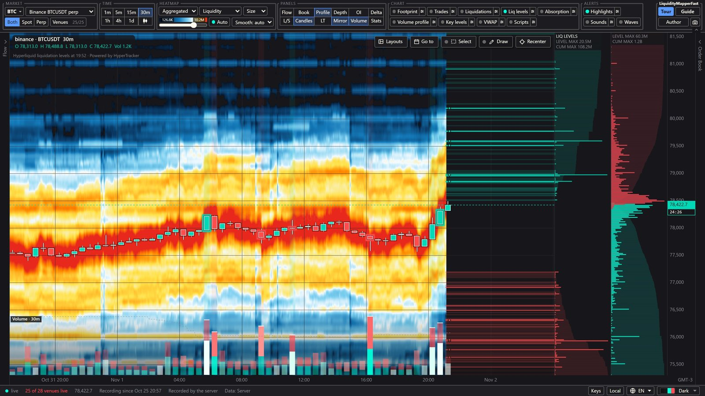

# LiquidityMapperFast

A free, open-source live liquidity heatmap, order book and footprint for crypto: the books of up to eleven spot and perpetual markets
on seven exchanges (the default set) on one map, for about 150 coins, Bitcoin first. It runs in your browser, with no sign-up.

**[Open it: liquiditymapper.com](https://liquiditymapper.com/)**



<sub>A day of BTC, recorded by the optional local server reading 25 markets: the order books as a heatmap behind the candles,
Hyperliquid's liquidation levels and the book's profile on the right.</sub>

## What you see

- **The heatmap**: the resting orders of every market you switch on, added up behind the candles, with the order book and its profile
  beside them.
- **Flow**: each exchange's cumulative volume delta (spot and perpetuals in colours of their own), the **Tape** of market orders, the
  **Footprint**, **Bar stats**, **Delta** and CVD candles, and **Flow history**.
- **Derivatives**: open interest, funding, long/short ratios and liquidations across exchanges; for BTC, Hyperliquid's **Liquidation
  levels**.
- **Chart tools**: VWAP and anchored profiles, TPO (Market Profile), Volume profile, Key levels, drawing tools, and your own indicators
  in **Scripts**.
- **Alerts**: **Highlights** mark the bars that stand out against the ones before them, in every pane at once; **Sounds** play on large
  sweeps of market orders and, if you choose, on rare events in a pane; **Waves** turn the panels to glass that large orders light up.
- **Your way**: saved layouts, 23 themes and your own, 12 languages, a backup file, and arrangements made for phones and tablets.

## How it works

The page connects to the exchanges' public feeds straight from your browser, in a Web Worker, and draws the live map from them. Your
settings, layouts, drawings and scripts stay in your browser. The site is a set of static files on Cloudflare Pages.

Two small services fill in what a browser cannot see on its own. One records history: BTC's order books, so the heatmap opens with the
hours before you arrived, and the flow, liquidations and open interest of BTC and twenty more of the most traded coins. The other serves
Hyperliquid's BTC liquidation levels. **Plus**, an optional paid part, pays for them. It opens the levels' history
older than a week, the levels of profitable traders, and stop and take-profit levels; everything else is free.

On your own computer, the page can also use a local server that records up to a week of history to SQLite and serves the page.

## Run it yourself

You need Node.js 22.5 or later.

```bash
git clone https://github.com/Karlheinzniebuhr/LiquidityMapperFast.git
cd LiquidityMapperFast
npm install
npm run dev:client   # the page alone, reading the exchanges from your browser: http://localhost:5173
npm run dev          # builds, then starts the local server (it keeps a week of history once it runs): http://127.0.0.1:8787
```

`npm test` runs the tests and `npm run build:site` builds the static site into `dist/`.

## Read more

- The **Guide** inside the page explains every control, and a one-minute **Tour** shows you around on a first visit.
- [docs/reference.md](docs/reference.md): every feature in detail, for people working on the code.
- [docs/guides/your-setup.md](docs/guides/your-setup.md): layouts, your own themes, and backups.
- [docs/coins.md](docs/coins.md), [docs/languages.md](docs/languages.md), [docs/deployment.md](docs/deployment.md) and
  [docs/plus.md](docs/plus.md).

## Feedback

Found a bug or have an idea? [Open an issue](https://github.com/Karlheinzniebuhr/LiquidityMapperFast/issues), or write to
[@karlbooklover](https://x.com/karlbooklover) on X. If the page is useful to you, a star on this repository helps other traders find it.

## Licence

The code is MIT, see [LICENSE](LICENSE). The data the page's own servers record and serve (the history, the liquidation levels, the stop
and take-profit levels) is not part of that licence: a site, app or copy of the code that uses it must show the credit
**Data: liquiditymapper.com**, linked to the site, where the data appears. See the [terms](https://liquiditymapper.com/terms/#data-credit).
